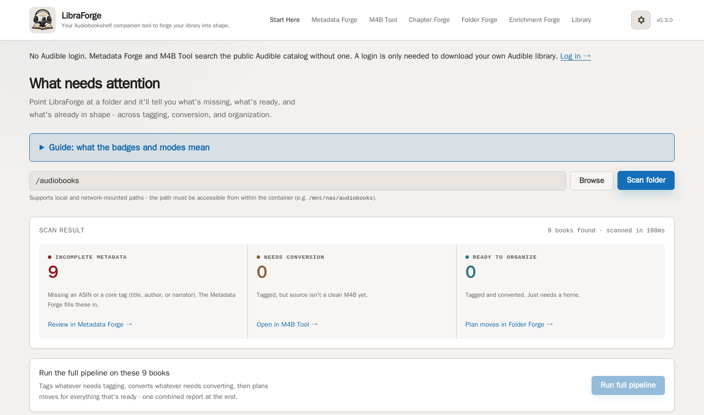
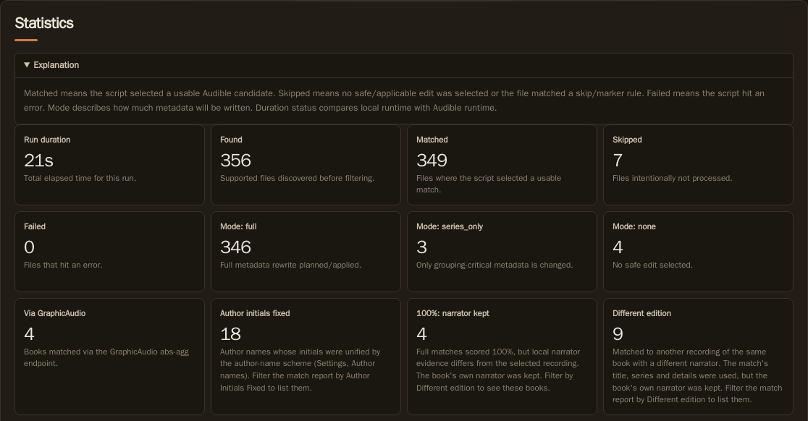
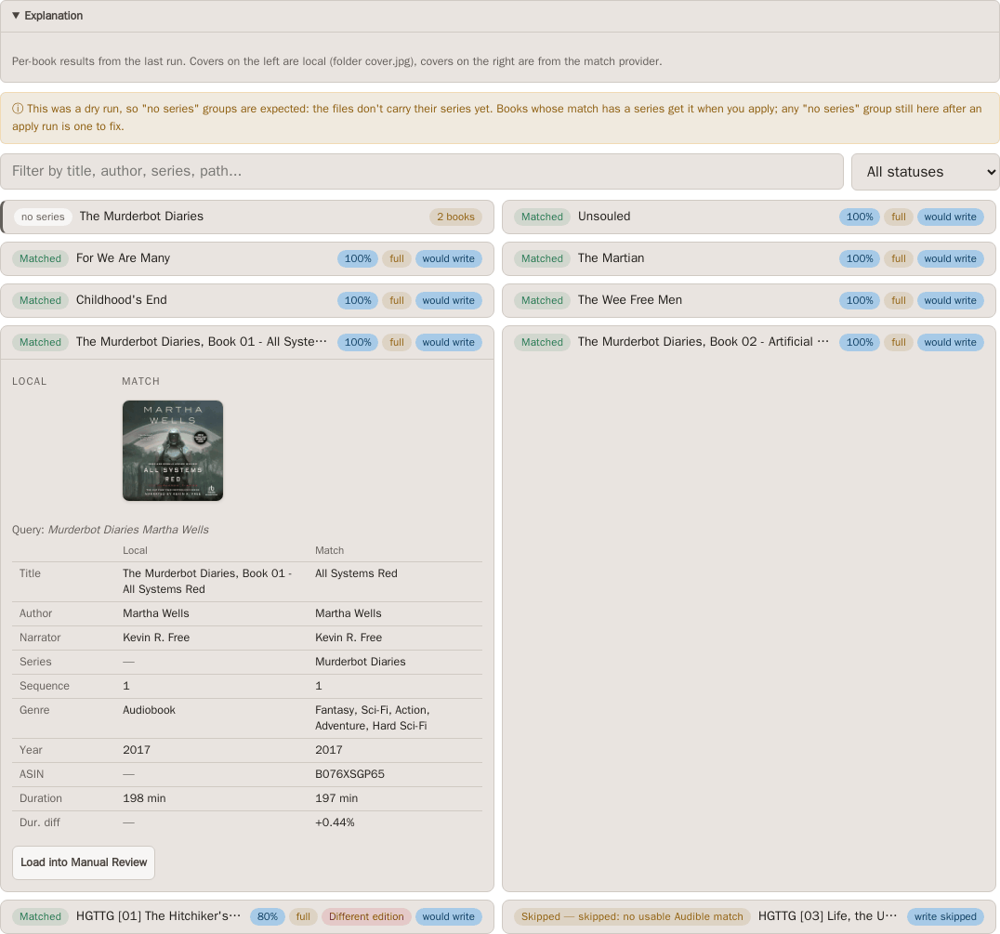
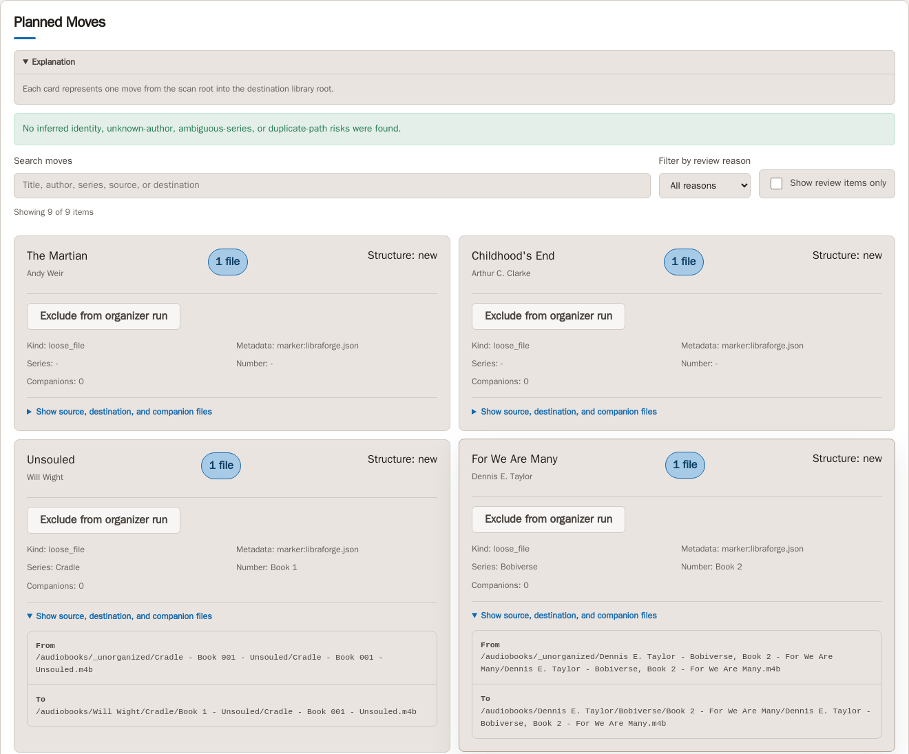
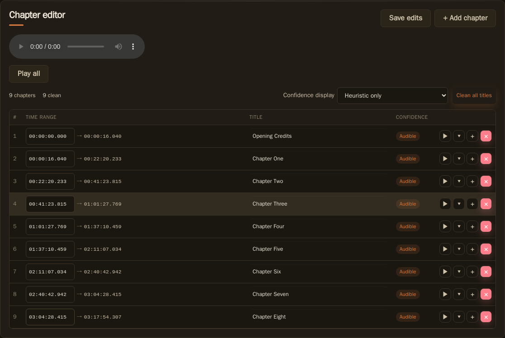

<p align="center">
  
</p>

<h1 align="center">LibraForge</h1>

<p align="center"><b>Your audiobook library, forged into shape.</b><br>
Clean up. Organize. Enrich.</p>

LibraForge is a self-hosted web app that tidies an audiobook library. It identifies each
book from several sources (Audible, Audiobook Guild, GraphicAudio, AudioSilo, Goodreads and
more), fixes its tags and cover, finds its chapters, merges loose parts into one M4B, and
files everything into neat `Author/Series/Book` folders, ready for
[Audiobookshelf](https://www.audiobookshelf.org/).

Every run is a **dry run first**: you see exactly what would change, and nothing is
written until you choose Apply.

> LibraForge is a work in progress, so features and screens may change. It is built with
> heavy help from AI (Claude), under human direction and review.

## See it in action

**Start Here** scans a folder and tells you what each book still needs.



**Metadata Forge** looks every book up across several sources, checks each candidate's
title, author, series number, narrator and runtime, and shows what would change before
writing anything. This dry run over 356 books, still carrying their original tags, took
21 seconds:



Every book's change is shown field by field. Here *Children of Strife* was tagged as book 1
of a series named "Children of Time, Book #4"; it gets the real series, number and genres.



**Folder Forge** plans where each book belongs and shows every move before making it. A
move that would land on a book already in your library is blocked, not merged.



**Chapter Forge** finds a book's chapters (from Audible, or by listening to the audio)
and lets you edit them with a player.



## The tools

| Tool | What it does |
|---|---|
| **Start Here** | Scans a folder: what needs metadata, conversion, or a new home. |
| **Metadata Forge** | Matches each book across Audible (no login needed), Audiobook Guild, GraphicAudio and SoundBooth Theater, AudioSilo and, if you turn it on, Goodreads, then writes the tags and cover. Includes a manual review for the hard cases. |
| **M4B Tool** | Merges multi-part books and converts other formats into a single M4B. |
| **Chapter Forge** | Finds, edits and saves a book's chapters. |
| **Folder Forge** | Moves books into `Author/Series/Book N - Title` folders, using a naming template you can change. |
| **Enrichment Forge** | Fills in genres and narrators for a whole series in Audiobookshelf at once. |
| **Library** | Downloads the books you own on Audible, as M4B with chapters and cover. |

More detail on every tool and setting: [docs/features.md](docs/features.md).

## Quick start

With Docker:

```bash
docker run -d --name libraforge \
  --user "$(id -u):$(id -g)" \
  -p 127.0.0.1:5056:5056 \
  -v /path/to/your/audiobooks:/audiobooks \
  -v libraforge-auth:/auth \
  -v libraforge-reports:/app/reports \
  -v libraforge-settings:/app/settings \
  -e LIBRAFORGE_SETTINGS_DIR=/app/settings \
  ghcr.io/coconautilus17/libraforge:latest
```

Then open **http://127.0.0.1:5056**. That's all you need to start matching. An Audible
sign-in (Settings → Accounts) is only needed to download your own books.

Running from a clone, the image with local speech recognition for chapters, optional
companion services and container paths: [docs/install.md](docs/install.md).

## Stay safe

- **Back up your library before the first Apply.** Dry runs change nothing, but Apply
  rewrites tags and moves folders.
- **Keep it private.** LibraForge has no login of its own, and anyone who can open it can
  change your files and use your Audible account. Leave it on `127.0.0.1`, or put it
  behind a VPN such as [Tailscale](https://tailscale.com/) or a reverse proxy with
  authentication.
- Use a dedicated folder for Audible sign-ins, not your main audible-cli config.

## More

- [Features](docs/features.md): every tool, provider and setting.
- [Reporting an issue](docs/reporting-issues.md): what to attach to a bug report.
- [Developer documentation](docs/developer/README.md): how it is built and tested.
- [Credits and licenses](THIRD_PARTY_NOTICES.md): LibraForge builds on FastAPI, Uvicorn,
  [audible](https://github.com/mkb79/Audible), [mutagen](https://github.com/quodlibet/mutagen),
  [FFmpeg](https://ffmpeg.org/), Audiobookshelf, abs-agg and abs-tract.

LibraForge is licensed under [AGPL-3.0-or-later](LICENSE).
